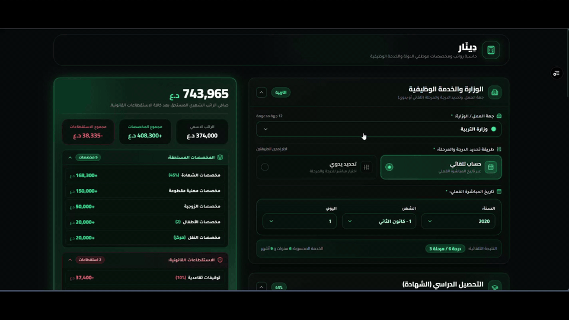

# Vamber AI — UI Context

Pick an element on a live webpage and copy focused, AI-ready UI context to your clipboard. Use it to tell a coding assistant exactly which part of the interface you want to change—without relying on a screenshot alone.

## Demo

## Features

- **Alt + Left Click** selects an element and copies a structured, AI-ready prompt with a unique CSS selector and a task placeholder.
- A nearby section or modal label, key accessibility attributes, and the React component name are included when available. Optional details are omitted when the page does not expose them.
- Hold **Alt** to preview the element with a cyan outline. Press **Esc** to clear the preview.
- A short green flash and confirmation toast indicate a successful copy.
- **Compact** mode keeps prompts short. It includes a unique CSS selector, the element tag and label, up to 500 characters of classes, and short text.
- **Detailed** mode includes up to 1,200 characters of classes, useful attributes, layout and state details, and a shortened HTML snippet.
- The toolbar icon shows a **NEW** badge when a newer GitHub Release is available. The update icon in the popup opens that release.
- The popup offers links to the developer's website and social profiles.

## Install in Chrome

Vamber AI is a plain Manifest V3 extension and does not need a build step.

1. Download or clone this repository and extract it if needed.
2. Open `chrome://extensions` in Chrome.
3. Turn on **Developer mode**.
4. Select **Load unpacked** and choose the folder containing `manifest.json`.
5. Pin Vamber AI from Chrome's Extensions menu for quick access.

To load a newer downloaded version, replace the extension files and select **Reload** on `chrome://extensions`.

## Use it

1. Open a regular website using `http://` or `https://`.
2. Hold **Alt** and move the pointer over the target to preview it.
3. Keep holding **Alt** and left-click to copy the context. Replace `Task: [Describe_the_change]` with the requested change before sending it to your coding assistant.
4. Choose **Compact** or **Detailed** in the popup to control how much context is copied.

The copied context may include the element's text, classes, accessibility labels, link address, data attributes, and—when Detailed mode is selected—a shortened HTML snippet. Review it before sharing, especially when selecting elements near private or account data.

https://github.com/user-attachments/assets/af22f778-0d4f-4aec-aef1-89fbf6fed810

## Privacy & Permissions

- **100% Local & Private**: Element context and DOM data are processed locally and never leave your machine.
- **Minimal Permissions**: Requires `clipboardWrite` to copy context, `storage` to save preferences, and `alarms` for background update checks.

## Limitations

- Internal browser pages (`chrome://`, Chrome Web Store) cannot be inspected due to browser security restrictions.
- WebGL and Canvas graphics are treated as single elements rather than individual DOM nodes.

## Credits

Designed and developed by **Ahmed Al-jaberi**.

- [CYBORG website](https://iq-cyborg.vercel.app/)
- [Telegram](https://t.me/YYxYY)
- [Instagram](https://instagram.com/3BF)
- [GitHub](https://github.com/De4d0t)

## License

No license file is included yet. Choose and add a license before inviting others to reuse or redistribute the code.
