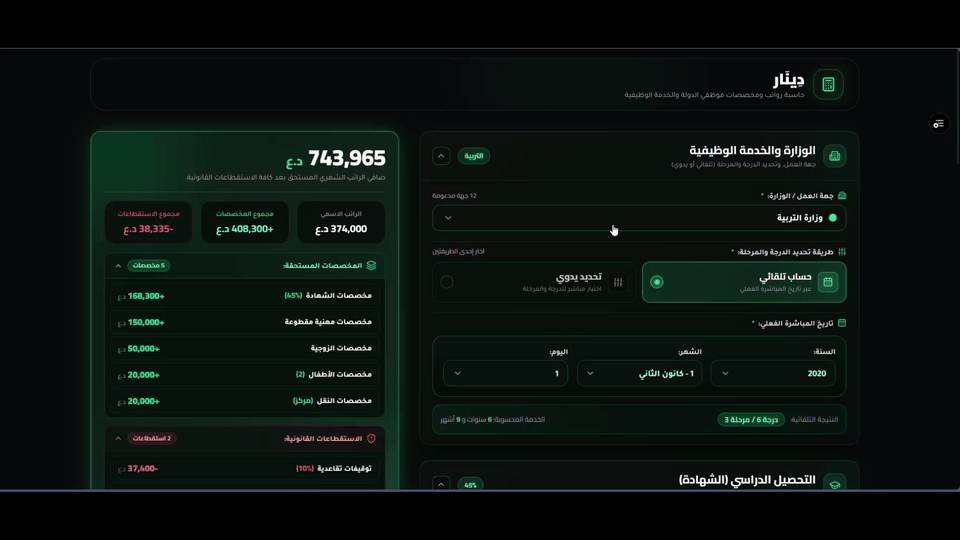

# Vamber AI — UI Context

Pick an element on a live webpage and copy focused, AI-ready UI context to your clipboard. Use it to tell a coding assistant exactly which part of the interface you want to change—without relying on a screenshot alone.


## Demo



## Features

- **Shift + Left Click**: Instantly copy structured, token-efficient UI context (page route, viewport breakpoint & theme, React/Vue/Svelte component, usage-site source file, component props, clean CSS selector, and current computed styles).
- **Shift + D + Left Click**: Hold `Shift + D` (outline turns rose-red) and left-click an element to copy its context pre-filled with a clean, AI-ready instruction to remove the element and clean up unused code.
- **Shift + F + Left Click**: Hold `Shift + F` (outline turns amber) and left-click an element to copy its context pre-filled with an instruction to trace and fix its event handlers, state, and logic.
- **Shift + A + Left Click**: Hold `Shift + A` (outline turns violet) and left-click additional elements to append them into a single multi-element clipboard payload (`Element 1`, `Element 2`…).
- **Live Hover Preview**: Hold **Shift** to outline elements in cyan before selecting (`Esc` to dismiss).
- **Compact & Detailed Modes**: Toggle between lightweight context and full DOM/attribute details.
- **Visual Feedback**: Immediate flash and toast notification upon copying to clipboard.
- **Update Alerts & Auto-Sync**: Automatic toolbar badge notification, OTA `content.js` sync from GitHub, and an in-popup **Reload** button.

## Install in Chrome

Vamber AI is a plain Manifest V3 extension and does not need a build step.

1. Download or clone this repository and extract it if needed.
2. Open `chrome://extensions` in Chrome.
3. Turn on **Developer mode**.
4. Select **Load unpacked** and choose the extension folder.
5. Pin Vamber AI from Chrome's Extensions menu for quick access.

To load a newer downloaded version, replace the extension files and click the **Reload** icon right inside the Vamber AI popup.

## Use it

1. Hold **Shift** and move the pointer over the target to preview it.
2. Keep holding **Shift** and left-click to copy the context (replacing `Task: [ __________ ]` with your requested change)—or hold **Shift + D** and left-click to automatically fill `Task:` with a ready-made instruction to remove the element and clean up unused code.
3. Choose **Compact** or **Detailed** in the popup to control how much context is copied.

### What the agent receives

```
## Element: button "Save changes"
Task: [ __________ ]
- Page: `/settings` | Viewport: 1280px (xl) | Theme: dark
- Source: `src/app/settings/settings-form.tsx:88` (SettingsPage > SettingsForm > Button)
- Defined in: `src/components/ui/button.tsx:45`
- Props (Button): variant="outline" size="sm"
- Selector: `button[data-slot="button"]`
- Classes: `inline-flex items-center px-4 md:px-6`
- Style: 143×34px | font 14px/500 | color #fafafa | bg #18181b | p 8px 16px | radius 6px
```

- **Source** points to where the element is *used*; when it lives in a shared UI kit (`components/ui`, `primitives`…), **Defined in** shows the primitive's file. Otherwise **Used in** shows where the owning component is rendered.
- Line numbers prefixed with `~` come from React 19 debug stacks and may be slightly off.
- Text is copied as written in the source (CSS `text-transform` is ignored), so it can be searched directly in the codebase.

The copied context may include the element's text, classes, accessibility labels, link address, data attributes, and—when Detailed mode is selected—a shortened HTML snippet. Review it before sharing, especially when selecting elements near private or account data.

## Author & Contact

Designed and developed by **Ahmed Al-jaberi**.

<p align="left">
  <a href="https://iq-cyborg.vercel.app/">
    
  </a>
  <a href="https://t.me/YYxYY">
    
  </a>
  <a href="https://instagram.com/3BF">
    
  </a>
</p>

## License

This project is open-source under the [MIT License](LICENSE).
